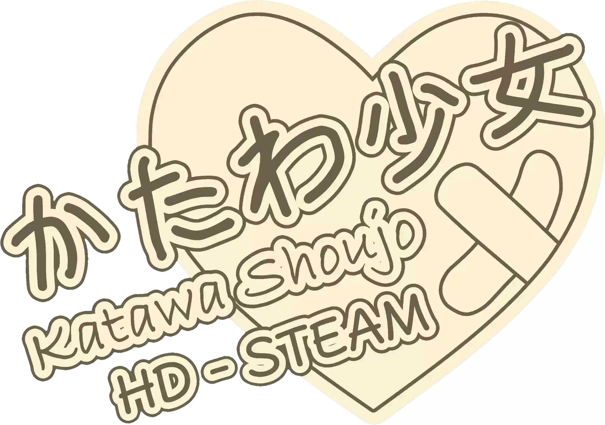

<p align="center">
  
</p>

# Katawa Shoujo HD Patch — Steam Edition (1080p)

<p align="center">
   <a href="../README.md">English</a> ·
   <b>Español</b> ·
   <a href="README.fr.md">Français</a> ·
   <a href="README.ja.md">日本語</a> ·
   <a href="README.de.md">Deutsch</a> ·
   <a href="README.ko.md">한국어</a> ·
   <a href="README.pl.md">Polski</a> ·
   <a href="README.pt-BR.md">Português (Brasil)</a> ·
   <a href="README.ru.md">Русский</a> ·
   <a href="README.zh-CN.md">简体中文</a> ·
   <a href="README.zh-TW.md">繁體中文</a>
</p>

**Juega la versión de Steam de Katawa Shoujo en 1920×1080 panorámico, R18 incluido.**

Un parche no oficial hecho por fans que hace que la versión de Steam de **Katawa Shoujo**, la novela visual
de Four Leaf Studios, funcione en **Full HD (1920×1080, panorámico 16:9)** en lugar de su resolución original
de 800×600 (4:3). Los fondos, los sprites de los personajes, los CG, la interfaz y los videos se reemplazan por
versiones en HD. Funciona con el motor Ren'Py 6.16 de la versión de Steam, en sus 11 idiomas.

**[Descargar la última versión](https://github.com/ohshya/KatawaShoujoSteamHD/releases/latest)**

> Es una adaptación del [Katawa Shoujo HD Patch](https://github.com/letow/KatawaShoujoHDPatch) de **letow**.
> Todo el arte en HD (fondos, sprites, CG, interfaz, efectos y videos) viene de ese proyecto. Los créditos completos
> están al final.

## Novedades de esta edición

Funciones exclusivas de esta edición, que no están en el parche HD original:

- **Los 11 idiomas de Steam.** El parche original cubría inglés, español, francés y japonés, con alemán y ruso
  como extras. Esta edición añade coreano, polaco, portugués de Brasil y chino simplificado y tradicional,
  incluidas sus escenas R18. Los cuatro paneles de cómic en polaco (`comic_vfx*_pl`), que faltaban en el parche
  original, se hicieron en HD de la misma forma que los de los demás idiomas.
- **Compatibilidad con la versión de Steam.** Los ajustes HD (resolución, posiciones, zooms, paneos y diseño de
  la interfaz) se aplican sobre los scripts de Steam en lugar de reemplazarlos, así que las funciones de Steam
  siguen funcionando: logros, soporte para mando, la opción de R18 y los archivos de idioma empaquetados.
- **Parche R18 en HD.** `r18_hd.rpa` reemplaza al `r18.rpa` oficial con las mismas escenas en HD.
- **Pantalla de idiomas con desplazamiento.** Mantiene el diseño HD y se desplaza para que quepan los 11 idiomas.
- **Ventana que se ajusta a la pantalla.** El juego se abre en una ventana centrada al 90% del área útil del
  escritorio (sin la barra de tareas ni la barra de título), entre 1280×720 y 1920×1080 y nunca más grande que
  la pantalla. La pantalla completa funciona igual que antes.
- **Base del juego más reciente.** Está hecho sobre los scripts actuales de Steam (v1.3.2) en lugar de Katawa
  Shoujo 1.3/1.3.1, así que se conservan las correcciones posteriores del juego.
- **Archivos empaquetados en lugar de sueltos.** Los recursos HD vienen en dos archivos `.rpa`, así que instalar
  y quitar el parche solo consiste en añadir o borrar archivos.

## Descripción

El parche HD original se hizo para la versión StandAlone de Katawa Shoujo (Ren'Py 6.10), que incluye el
contenido para adultos dentro del propio juego. La versión de Steam usa un Ren'Py más nuevo (6.16.5), separa
ese contenido en un parche R18 aparte (`r18.rpa`) con el arte original en 4:3 y añade funciones propias. Por
eso, el parche original hace que la versión de Steam se cierre con un error.

Esta edición lleva la misma remasterización HD a la versión de Steam e incluye el parche R18 en HD.

### Cambios visuales

Esta edición es una adaptación del código: no añade cambios visuales nuevos, así que el juego se ve igual que
con el parche HD original. Para ver las comparaciones de antes y después, visita el [repositorio original del
Katawa Shoujo HD Patch](https://github.com/letow/KatawaShoujoHDPatch).

## Idiomas disponibles

Inglés, español, francés, japonés, alemán, coreano, polaco, portugués de Brasil, ruso, chino simplificado y
chino tradicional: los 11 idiomas de la versión de Steam.

## Instalación

No hace falta instalador.

> **Descarga el parche desde la página de [Releases](https://github.com/ohshya/KatawaShoujoSteamHD/releases/latest).**
> El repositorio contiene la herramienta de compilación; los archivos HD (`patch-hd.rpa`, de unos 660 MB, y
> `r18_hd.rpa`) solo están en el zip del release.

1. Descarga [`KS-HD-1.0.2-Steam-Patch.zip`](https://github.com/ohshya/KatawaShoujoSteamHD/releases/download/v1.0.2/KS-HD-1.0.2-Steam-Patch.zip) del último release.
   Es el único archivo que necesitas para jugar. El otro, `Assets-For-Building-Only`, solo sirve para
   compilar el parche por tu cuenta.
2. En Steam, haz clic derecho en **Katawa Shoujo** > **Administrar** > **Ver archivos locales**.
3. Extrae el zip en esa carpeta (la que contiene `Katawa Shoujo.exe`).
4. Cuando te lo pregunte, elige **reemplazar todos los archivos**.
5. Abre el juego desde Steam.

**Linux y macOS:** el parche solo reemplaza datos del juego (scripts y archivos empaquetados), que son iguales
en todos los sistemas. En Linux los pasos son idénticos. En macOS, **Ver archivos locales** abre una carpeta con
la aplicación del juego: haz clic derecho sobre ella, elige **Mostrar contenido del paquete** y combina la
carpeta `game` del zip con la carpeta `game` que hay dentro.

No hace falta el `r18.rpa` oficial. Si ya está en la carpeta, puedes dejarlo; el juego usa la versión HD.

**Para desinstalar:** borra `game/patch-hd.rpa` y `game/r18_hd.rpa` (y `game/r18-hd.rpa` si instalaste la v1.0.0 o la v1.0.1), y luego en Steam ve a
**Propiedades** > **Archivos instalados** > **Verificar integridad de los archivos del juego**.

> Una actualización de Steam puede sobrescribir los scripts parcheados. Si pasa, vuelve a extraer el parche.

> **Usa la rama normal de Steam.** El parche está hecho para la versión principal del juego (Ren'Py 6.16).
> Todavía no funciona con la beta **modern - Ren'Py 8 branch**: si la elegiste, vuelve a la rama normal en
> **Propiedades** > **Betas** antes de instalar el parche. Se está trabajando para que también funcione en la
> rama de Ren'Py 8.

### Qué contiene el zip del release

| Archivo | Descripción |
|---|---|
| `game/patch-hd.rpa` | Fondos, sprites, CG, interfaz, efectos y videos en HD. |
| `game/r18_hd.rpa` | El parche R18 en HD. Reemplaza al `r18.rpa` oficial. |
| `game/*.rpyc` | Scripts del juego de Steam con los ajustes de diseño HD, para los 11 idiomas. |
| `game/presplash.png` | Pantalla de carga del parche HD. |

## Preguntas frecuentes

**¿Funciona con la rama "modern - Ren'Py 8 branch" de Steam?**
Todavía no; se está trabajando en ello. El parche está hecho para la rama normal (Ren'Py 6.16), y la beta de
Ren'Py 8 usa otro formato de scripts, así que instalar este parche ahí rompería el juego.

**¿Necesito el parche R18 oficial (`r18.rpa`)?**
No. `r18_hd.rpa` ya contiene las escenas R18 en HD, y la opción del juego para desactivarlas sigue funcionando.

**¿Es lo mismo que el Katawa Shoujo HD Patch de letow?**
Usa el mismo arte HD y los mismos ajustes de escenas, adaptados a la versión de Steam, más los cambios de
"Novedades de esta edición". El parche original de letow está hecho para la versión StandAlone y en Steam hace
que el juego se cierre con un error.

**¿Funciona en Linux, macOS o Steam Deck?**
Debería: el parche solo cambia datos del juego, que son iguales en todos los sistemas. De momento solo se ha
probado en Windows, así que los reportes son bienvenidos.

**¿Cómo vuelvo al juego original?**
Borra `game/patch-hd.rpa` y `game/r18_hd.rpa`, y luego usa **Verificar integridad de los archivos del juego**
en Steam.

## Compilar desde el código fuente

El repositorio contiene el código que genera el parche: los cambios HD guardados como datos y una
herramienta que los aplica a tu propia copia del juego. Los archivos del juego y el arte HD no están incluidos.

La herramienta existe por transparencia, para que cualquiera pueda ver exactamente qué cambia el parche y
volver a compilarlo. Adaptar el parche HD requirió extraer información de la versión StandAlone de Katawa
Shoujo, de la versión de Steam, del `r18.rpa` oficial y del parche HD para StandAlone, y compararlas para
encontrar cada cambio que hace el parche HD. Esos módulos de extracción solo hicieron falta una vez y se
dejaron fuera: su resultado está guardado en `kshd/edits`.

### Uso de IA

El port fue un proceso largo y desorganizado, con cantidades masivas de código de prueba descartable y
experimentos. Publicar las herramientas originales, escritas a mano durante el proceso, no era viable y no
habría servido de nada. Por eso, la herramienta de compilación de este repositorio se creó con
**Claude (Opus 5.5)**, de Anthropic, para tener una forma limpia y fiable de compilar el parche a partir de los
datos que produjo el port.

### Requisitos

- [Python](https://www.python.org/) 3.9 o más reciente. No hace falta ningún paquete adicional.
- La versión de Steam de Katawa Shoujo, **sin modificar** y en la rama normal (no la beta de Ren'Py 8).
- El paquete de recursos HD: [`KS-HD-1.0.2-Assets-For-Building-Only.zip`](https://github.com/ohshya/KatawaShoujoSteamHD/releases/download/v1.0.2/KS-HD-1.0.2-Assets-For-Building-Only.zip) (unos 700 MB).

### Compilar

1. Clona o descarga este repositorio.
2. Dale a la herramienta acceso al juego, de una de estas dos formas:
   - **Una copia del juego en el repositorio:** copia la carpeta del juego (la que contiene
     `Katawa Shoujo.exe`) en la raíz del repositorio y llámala `Katawa Shoujo`. Usa una copia hecha antes de
     instalar el parche. Con esta opción, la instalación de Steam puede seguir parcheada mientras compilas.
   - **La instalación de Steam:** si no hay una copia en el repositorio, la herramienta busca el juego en tus
     bibliotecas de Steam. Si ya instalaste este parche ahí, antes usa **Verificar integridad de los archivos
     del juego** en Steam.
3. Pon `KS-HD-1.0.2-Assets-For-Building-Only.zip` en la carpeta `assets`, comprimido o extraído.
4. Ejecuta:

```bash
python build.py
```

La herramienta parchea los scripts y crea `KS-HD-1.0.2-Steam-Patch.zip` junto a `build.py`. Ese zip es el
parche: instálalo como se explica en "Instalación".

Si un script no coincide con lo que espera el parche, la compilación se detiene e indica cuál: eso pasa
cuando los archivos del juego están modificados o son de otra versión.

### Cómo funciona

El parche HD solo cambia algunas cosas de los scripts del juego: la resolución, las posiciones, los zooms, los
paneos y el diseño de la interfaz, además del tamaño de la ventana descrito en "Novedades de esta edición".
Esos cambios se guardan como datos legibles en `kshd/edits`, un archivo JSON por script:

- **`code`**: reemplazos en el código de la interfaz, cada uno con el texto original exacto y cuántas veces
  debe aparecer, para detectar una versión equivocada del juego en lugar de parchearla mal.
- **`nodes`**: cambios en las instrucciones de escena (`show`, `scene` y transformaciones ATL), localizadas por
  su etiqueta y su contenido original, para que el mismo archivo sirva para los 11 idiomas.

| Archivo | Función |
|---|---|
| `build.py` | Encuentra el juego y los recursos, parchea los scripts en paralelo y crea el zip del parche. |
| `kshd/edits/*.json` | Los cambios HD, como datos. |
| `kshd/patch.py` | Aplica un archivo de cambios a un script. |
| `kshd/tree.py` | Recorre la estructura de los scripts para encontrar el código y las instrucciones que hay que cambiar. |
| `kshd/rpyc.py` | Carga y guarda los scripts compilados `.rpyc`, manteniéndolos compatibles con Ren'Py 6.16. |
| `kshd/rpa.py` | Lee y escribe archivos `.rpa` de Ren'Py. |

### Paquete de recursos HD

Las imágenes, los videos y las escenas R18 se guardan en el paquete de recursos, separados del código, para
poder mejorarlos sin tocarlo. El arte HD viene del [Katawa Shoujo HD
Patch](https://github.com/letow/KatawaShoujoHDPatch) de letow, escalado con waifu2x de nagadomi. Lo único que
añade esta edición son los cuatro paneles de cómic en polaco, hechos de la misma forma que los demás:

```
presplash.png    pantalla de carga
hd/              fondos, sprites, CG, interfaz, efectos y videos (empaquetados en patch-hd.rpa)
r18/             escenas R18 y sus imágenes (empaquetadas en r18_hd.rpa)
```

Para actualizar el arte, extrae el paquete en la carpeta `assets`, reemplaza o añade archivos con los mismos
nombres y carpetas, y compila. Para compartirlo, vuelve a comprimir la carpeta y súbela a un release.

## Pruebas y comentarios

El parche pasa el lint de Ren'Py con las mismas advertencias que el juego de Steam sin modificar. Se
comprobaron en el juego los menús, las opciones, la pantalla de guardado, la galería, el opening y varias
escenas de la historia y R18, y se comparó cada instrucción de escena y cada definición de imagen con el
parche HD original. Katawa Shoujo es un juego largo y no se han jugado todas las escenas de todas las rutas e
idiomas, así que **necesita más pruebas**. Solo se ha probado en Windows; los reportes de jugadores de Linux y
macOS son especialmente bienvenidos.

Si encuentras un sprite mal colocado, un CG recortado, un elemento de la interfaz fuera de lugar o cualquier
otro problema, abre un issue con la escena, el idioma y, si puedes, una captura de pantalla. Las
contribuciones también son bienvenidas.

## Licencia

Este es un proyecto de fans no oficial y sin fines comerciales, y no está asociado con Four Leaf Studios.
Todos los derechos del juego y de sus recursos pertenecen a sus respectivos dueños.

## Créditos

- **[letow](https://github.com/letow)**, autor del
  [Katawa Shoujo HD Patch](https://github.com/letow/KatawaShoujoHDPatch) ("Remastered by Letow"). letow escaló
  cada recurso, rediseñó la interfaz para 16:9 e hizo los ajustes de escenas en los que se basa este port.
- **[Four Leaf Studios](https://www.katawa-shoujo.com/)**, creadores de Katawa Shoujo.
- **[nagadomi](https://github.com/nagadomi)**, autor de **waifu2x**, el escalador por IA que usó el parche HD
  original.
- **Novellae Subs** (traducción al ruso) y **HikariTranslations** (traducción al alemán), acreditados en el
  parche HD original.
- **Valjean_Lafitte**, acreditado como inspiración en el parche HD original.
